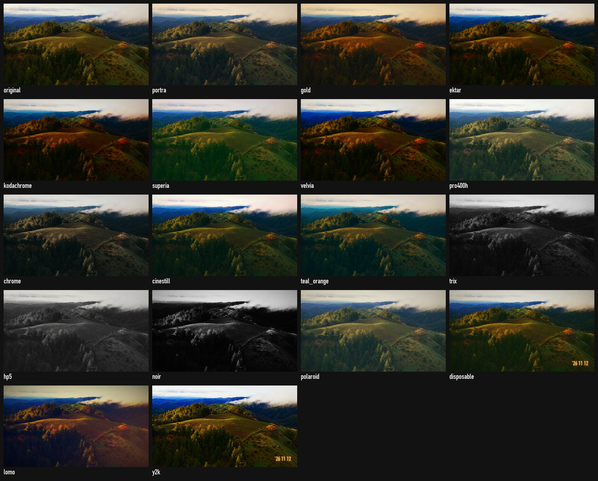

# PowerShot A480, unlocked

Two halves:

- **On the camera:** CHDK, plus 5 shooting-preset scripts (`CHDK/SCRIPTS/`)
- **On the Mac:** 17 film filters, `.cube` LUTs, and a merge tool for trails, night noise and HDR



---

## 1. Put CHDK on the camera (one time, ~10 min)

**Check firmware.** CHDK supports the A480 on firmware **1.00B**.

1. On the Mac, create an empty file named `ver.req` in the root of the SD card:
   ```bash
   touch /Volumes/<CARDNAME>/ver.req
   ```
2. Put the card in the camera and turn it on in **playback** mode.
3. Hold **FUNC.SET**, then press **DISP**. The firmware version appears on screen.

**Download CHDK.** Go to <https://mighty-hoernsche.de>. Find **a480**, then **100b**, and get the **complete** zip.

**Load it.** Pick one method.

- **Easy (per session).** Unzip everything onto the card root. Then: playback mode → MENU → **Firm Update…** → OK. CHDK runs until power-off, and you redo this each time.
- **Autoboot (set and forget).** Make the card bootable with **STICK** (<https://zenoshrdlu.com/stick/>, needs Java). STICK reads the firmware, downloads the right build and prepares the card. A **4GB or smaller card** is the least hassle on a camera this old. Then slide the card's **lock tab to LOCKED**. The camera still writes photos, and CHDK boots on its own.

**Copy these scripts.** Copy `CHDK/SCRIPTS/*.LUA` from this folder into `CHDK/SCRIPTS/MINE/` on the card. Use the subfolder because CHDK ships its own `hdr.lua` / `motion.lua` and the card ignores case.

### First-time CHDK settings

- **ALT mode** = a **short press of MODE**. A long press still does the normal mode thing.
- In ALT mode, press **MENU** for the CHDK menu, then:
  - **RAW parameters → Save RAW: ON, DNG format: ON.** The first time, CHDK may ask to create `badpixel.bin`. Say yes and let it finish.
  - **OSD / Histogram → live histogram + zebra ON.** Zebra shows blown highlights as stripes.
  - **Extra Photo Operations → Override shutter / ISO.** This is for manual control without scripts.
- Put the camera's own dial and mode in **P (Program)**. The scripts need it.

## 2. Shooting presets (camera scripts)

To run one: ALT mode → **FUNC.SET** → Load script → open `MINE` → pick a script → set params → **press the shutter** to run. Press the shutter again while a script is running to stop it.

| Script | What it's for |
|---|---|
| **PRESETS.LUA** — *Preset Shot* | Every press gives one shot with a full recipe: **Daylight, Golden, Night, Indoor, Party** (slow-sync flash, ambient + flash), **Disposable** (fixed 1/125 + flash, like a throwaway camera), **Action** (forces 1/500+), **Portrait**. Saves RAW. |
| **LONGEXP.LUA** — *Long Exposure* | Tripod: 1s–60s or Auto. Night city, light painting, silky water. Set **Shots 20+** for car trails or star trails. |
| **TIMELAPS.LUA** — *Timelapse* | Set the interval. Exposure lock stops flicker, and screen-off saves battery. |
| **HDR.LUA** — *HDR Bracket* | 3 or 5 frames, dark to bright. Merge on the Mac (below). |
| **MOTION.LUA** — *Motion Trigger* | Fires when something moves: birds, pets, lightning. **Experimental**, so tune sensitivity. |

Good pairings:

- Night preset + `cinestill`
- Party preset + `disposable`
- Golden preset + `gold` or `portra`
- Action preset + `trix`

## 3. Filters on the Mac

Setup is already done in this folder (`.venv`). To redo it on another machine:
```bash
python3 -m venv .venv && .venv/bin/pip install -r requirements.txt
```

```bash
./film list                                  # all the looks
./film apply portra ~/Desktop/DCIM/100CANON  # whole folder, saves to ./filtered
./film apply portra,trix,lomo IMG_0042.JPG   # a few looks
./film apply all IMG_0042.JPG                # every look
./film sheet IMG_0042.JPG                    # one contact sheet of all looks
./film apply gold IMG_0042.DNG --ev 0.5      # DNG + push 1/2 stop brighter
```

Options:

- `--strength 0.6` softens the look.
- `--no-grain` turns off grain.
- `--date` / `--no-date` forces the orange date stamp on or off.
- `--no-frame` removes the polaroid border.

**The looks:**

- **Kodak-ish:** portra, gold, ektar, kodachrome
- **Fuji-ish:** superia, velvia, pro400h, chrome
- **Cinema:** cinestill, teal_orange
- **B&W:** trix, hp5, noir
- **Lo-fi:** polaroid, disposable, lomo, y2k

### Make your own

Edit `filters/recipes.py`. Every number is commented. Copy a recipe, rename it, tweak it, then run `./film sheet` to compare.

### Use them in other apps (LUTs)

`luts/*.cube` holds the colour part of each look. Grain, glow and the date stamp aren't in the LUTs. The `.cube` files load in Lightroom (as a profile), Photoshop (Color Lookup), DaVinci Resolve, Final Cut, CapCut, VN, and most phone editors. Regenerate them after editing recipes:
```bash
./film luts
```

## 4. Merge bursts

```bash
./stack lighten ~/Desktop/trails/      # car/star trails from LONGEXP with 20+ shots
./stack mean    ~/Desktop/night5/      # 5-10 shots -> much less noise, silky water
./stack fuse    IMG_01*.JPG -o hdr.jpg # HDR bracket -> one natural-looking photo
./film apply velvia hdr.jpg            # ...then add a look
```

Timelapse to video (needs `brew install ffmpeg`):
```bash
ffmpeg -framerate 24 -pattern_type glob -i '*.JPG' -vf scale=1920:-2 -c:v libx264 -pix_fmt yuv420p timelapse.mp4
```

## Honest notes

- **Tested:** the filters, LUTs and merge tool, on real photos on this Mac. The scripts were dry-run against a fake camera, and their exposure maths checks out. They have **not been run on a real A480 yet.** If one misbehaves, note what the screen says and fix it from there.
- **Aperture:** the A480 has no adjustable aperture. Shutter and ISO are where the control is.
- **Remove CHDK:** unlock the card, or delete the files. Nothing is written to the camera's firmware.
